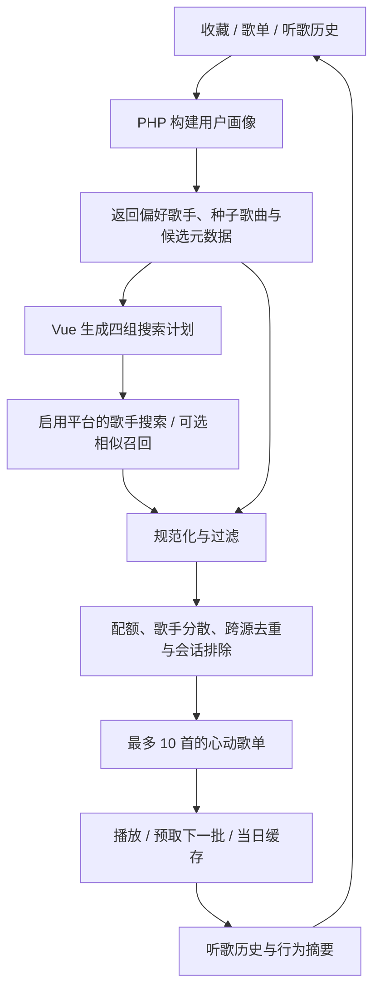

# 心动模式 · Heart Mode

心动模式是 XCloud音乐的个性化推荐模块：从用户曲库建立画像，根据画像向不同音源召回歌曲，再通过配额、去重和歌手分散策略组成每批最多 10 首的歌单。播放器可以在当前队列消耗后继续获取下一批。

本文说明心动模式的安装、推荐流程、接口、运维和扩展方式。源码路径以仓库根目录为基准，`deploy/php/` 对应发布包中的 `php/`。本说明保留在源码仓库，不复制到部署目录。

## 阅读导航

- [快速启用](#快速启用)
- [推荐如何生成](#推荐如何生成)
- [播放与行为反馈](#播放与行为反馈)
- [数据表与接口](#数据表与接口)
- [定时维护与排错](#定时维护与排错)
- [当前边界与二次开发](#当前边界与二次开发)

## 快速启用

### 1. 初始化数据库

先创建 utf8mb4 数据库，填写后端 `.env` 中的数据库连接与初始管理员账户。源码配置位于 `deploy/.env`，发布包配置位于根目录 `.env`。在源码或发布包根目录执行同一个命令：

```bash
php scripts/init-database.php
```

初始化脚本执行基础业务与后台建表逻辑，以及听歌历史、访问统计和心动模式的 SQL 文件，并检查全部 19 张表。重复执行保留业务数据与管理员密码，历史清理和画像重建由独立任务处理。

数据库和专用账户应预先创建，安装账户需具有建表、修改结构及数据读写权限。管理员初始密码至少 12 位，模板占位值不可使用。

### 2. 配置兼容音源

心动模式通过统一 `/php/music_source.php` 网关调用兼容音乐 API。后端使用 `XCLOUD_MUSIC_API_<编号>_URL/FORMAT/ENABLED/SOURCES`，支持编号 1–20、`local` 与 `meting` 两种明确协议；完整契约见 [MUSIC_API.md](../MUSIC_API.md)。平台开关 `XCLOUD_SOURCE_<平台大写>_ENABLED` 同时控制召回与播放，禁用源不会参与备用。

两种内置协议均不提供相似歌曲，`similar` 返回空列表。网易相似召回不能作为部署前提，推荐需依赖歌手搜索、画像候选等其他路径；实际批次数量仍受可用候选影响。

### 3. 建立初始统计与用户画像

先设置 `XCLOUD_LOGIN_ENABLED=1`。在心动模式仍关闭时，首次准备在发布包根目录运行：

```bash
php php/rebuild_heart_mode.php --mode=global --force
php php/rebuild_heart_mode.php --mode=users --force
# 指定用户重建，user-id 为正整数
php php/rebuild_heart_mode.php --mode=user --user-id=123 --force
```

源码运行时，将命令中的 `php/rebuild_heart_mode.php` 换成 `deploy/php/rebuild_heart_mode.php`。

`--force` 仅允许在心动开关关闭时准备画像，不能绕过登录开关；日常任务不添加此参数。`global` 汇总站内歌曲统计，`users` 重建全部用户画像，`user` 重建指定用户画像。画像构建依赖服务端已有的收藏、歌单和听歌历史。

### 4. 开启功能并使用

在后端 `.env` 设置：

```ini
XCLOUD_LOGIN_ENABLED=1
XCLOUD_HEART_MODE_ENABLED=1
XCLOUD_PHASE3_AUTH=1
```

登录用户的本地收藏、历史和歌单按 `source:id` 去重后达到 10 首时，首页显示「切换心动模式」。功能支持批次播放、手动换批和队列续接。服务端画像依赖账户数据同步后的数据库记录。

前端启动前加载服务器有效功能配置，只有登录及心动开关均开启时才可使用。关闭 `XCLOUD_LOGIN_ENABLED` 会使注册与心动模式自动不可用，并停止云同步，保留本地资料及账户凭据；关闭心动开关同样保留推荐表。禁用 HTTP 接口返回 `503 / FEATURE_DISABLED`，日常 CLI 重建跳过并成功退出，守卫先于数据库连接。修改服务器 `.env` 后刷新页面，无需重新构建。

## 推荐如何生成

### 总体流程



推荐采用规则、统计和随机探索策略，偏好信息来源于用户曲库与听歌历史。画像在服务端构建，搜索计划和配额选择在浏览器执行。

### 1. 用户画像与偏好权重

`heart_mode_profile.php` 负责规范化歌手、歌曲身份和画像；`heart_mode.php` 与重建脚本读取数据库：

| 输入 | 读取上限 / 权重 | 用途 |
| --- | --- | --- |
| 收藏 `favorites` | 每用户最多 5,000 行，单行权重 1 | 曲库偏好 |
| 歌单歌曲 `playlist_songs` | 每用户最多 10,000 行，单行权重 1 | 曲库偏好 |
| 听歌历史 `listen_history` | 每用户最多 10,000 行，权重 `max(1, listen_count)` | 常听歌手、历史种子与已听标记 |

画像保留历史与曲库两组优先歌手、两组优先歌曲、候选歌曲、已听集合和音源偏好。同一首歌在多个歌单中出现时，会贡献多行偏好权重；候选展示另行去重。

歌手偏好使用 `source|artist` 区分音源，合作歌曲会拆分参与歌手。歌曲定位使用 `source:id`，避免 QQ 与网易的相同数字 ID 被误认为同一首歌。同时通过规范化歌名和排序后的歌手组合识别跨音源重复，减少同一作品在一批中重复出现。

画像缺失或 `next_build_at` 已过期时，推荐请求会即时重建；正常有效期约一天。手动或定时重建会增加 `profile_version`，已有画像保存在数据库中。

### 2. 后端候选：提供偏好上下文与兜底歌曲

服务端从画像候选中排除客户端传来的歌曲键，过滤没有封面的条目，并计算：

```text
偏好分 = 2 × ln(1 + 同音源歌手偏好权重) − 已听惩罚
已听惩罚 = 已听过时为 2，否则为 0
```

`heartModeSelectCandidates()` 先尝试保持歌手多样性和相邻歌手分散，候选不足时可以放宽限制。返回内容不仅有 `songs`，还包含 `priority_artists`、`priority_songs`、`profile_candidates` 和 `search_context`，供前端继续召回。

后端 `songs` 作为候选输入，由前端与音源搜索结果合并后生成展示批次。后端返回 `CANDIDATE_SHORTAGE` 时，客户端仍可继续搜索补充候选。

### 3. 四组召回：相似探索与熟悉歌手搭配

`buildHeartModeSearchPlan()` 的标准目标是 10 个召回槽位：

| 组 | 信息来源 | 目标槽位 |
| --- | --- | --- |
| 1 | 从前 50 个网易历史种子中随机选最多两首，查询相似歌曲 | 2 首相似歌曲 |
| 2 | 历史中的偏好歌手 | 2 首新歌 + 1 首已听歌 |
| 3 | 收藏 / 歌单中的偏好歌手 | 2 首新歌 + 1 首已听歌 |
| 4 | 历史与曲库歌曲对应的歌手 | 1 首新歌 + 1 首已听歌 |

网易种子不足时，缺少的相似槽位分配至第 4 组的新歌 / 已听目标。「新歌」表示画像中未标记为已听或已有曲库的歌曲，与发行日期无关。

歌手按权重排序后分层抽样：55% 的概率选择前 15 位区间，40% 选择第 16–30 位，5% 选择第 31–50 位；区间为空时退回可用的前 50 位。搜索计划还优先避开已经选过的歌手，兼顾偏好强度和探索空间。

搜索使用网易、酷我、QQ 中已启用平台的统一网关，每轮最多 10 个去重查询。通常每次搜索请求 50 个结果，累计换批计数达到 10 后请求 100 个；实际分页条数取决于上游协议。同平台多个提供商由网关按编号备用，不再单独配置前端聚合搜索地址。内置 local/meting 的相似结果为空；上表相似槽位描述保留的算法路径，启用相似召回需要另行实现协议适配。

某歌手的搜索结果全部属于已听候选时，客户端最多调整两轮歌手计划。各组槽位为目标配额，实际数量取决于用户数据及上游结果。

### 4. 候选过滤与配额混排

搜索结果先统一字段，再过滤缺少 ID、歌名或封面的条目，以及标题含 Live、现场、演唱会、伴奏、instrumental、karaoke 的歌曲。普通歌手搜索还检查返回歌手是否匹配目标。

客户端按 `source:id` 和规范化歌名 / 歌手组合去重，将候选分类为 `similar`、`new`、`heard` 或 `library`。最终顺序由分类优先级、随机配额选择和歌手负载共同决定。

- 每批最多 10 首。
- 选择时优先每位歌手最多 2 首，不足时放宽到 3 首；合作歌手也计入数量。
- `heard` 分类最多 4 首；标为 `similar` 的歌曲属于独立分类，因此这不是所有实际听过歌曲的绝对数量上限。
- 不强制禁止同歌手相邻，主要用批次歌手数量来控制集中度。
- 会话中的 `seenKeys` 避免连续批次重复歌曲键；发给后端的排除列表最多 100 条，客户端仍用完整会话集合过滤。

跨源去重基于名称规范化，可能合并同名不同版本，也可能遗漏命名差异较大的同一作品。

## 播放与行为反馈

### 批次、缓存和连续播放

`HomeView.vue` 管理展示批次、实际播放队列和待提交的预取批次。用户点击歌曲后，当前展示批次成为播放队列；队列将耗尽时可通过 continuation 回调获取下一批，再在消费时更新展示。

当日批次按用户保存在浏览器本地，包含歌曲、会话 ID、已见歌曲键、批次索引和画像版本；跨日缓存失效。当天首次进入可刷新，手动换批限制为滚动 5 分钟最多 4 次。客户端交互节流与部署层限流分别配置。

### 行为摘要采集与同步

播放器在自然播放结束时产生 `completed`，通过 `next` 提前切歌且进度低于 90% 时产生 `skipped`。采集范围不包含全部暂停、拖动和页面离开行为。首页挂载时连接信号接收器，卸载时断开。

客户端按音源和歌曲 ID 聚合事件，保存在本地缓冲区，发送到 `heart_mode.php?action=sync_signals`。同步函数默认有 10 分钟节流；首页离开或 pagehide 时会尝试强制同步，失败保留缓冲。当前没有每隔 10 分钟自动执行的独立同步计时器，也不保证关闭浏览器时请求一定完成。

服务端使用 `(user_id, client_batch_id)` 避免同一批次 ID 重复入库；每个请求最多接受 50 条歌曲摘要，每条的完成 / 跳过计数裁剪到 0–1，播放计数裁剪到 0–20。客户端缓冲最多 100 条，目前发送前没有拆成多批，积累超过 50 条可能被拒绝，需要二次开发时补充分批发送。

当前画像权重来自收藏、歌单和听歌历史，`heart_mode_user_signals` 中的完成 / 跳过计数尚未参与评分。偏好更新通过听歌历史变化与画像重建生效，行为摘要保留供后续算法扩展。

## 数据表与接口

### 心动模式的 7 张表

| 表 | 当前职责 |
| --- | --- |
| `heart_mode_migrations` | 心动模式迁移版本标记 |
| `heart_mode_user_profiles` | 用户画像 JSON、版本与下次重建时间 |
| `heart_mode_song_stats` | global 重建生成的全站歌曲统计 |
| `heart_mode_user_signals` | 完成、跳过、播放行为摘要，尚未参与当前画像评分 |
| `heart_mode_signal_batches` | 行为上报的批次去重 |
| `heart_mode_metrics` | 推荐成功、候选不足、同步等按日计数 |
| `heart_mode_cooccurrence` | 预留歌曲共现结构，当前流程未构建或消费该表 |

画像还依赖基础表 `users`、`favorites`、`playlists`、`playlist_songs` 和 `listen_history`。`client_entry_stats` 用于客户端访问统计，与心动算法无直接关系，但统一初始化会一起安装。

### `/php/heart_mode.php`

三个 action 均需要登录身份，默认通过 `Authorization: Bearer <token>` 验证 `user_tokens`，并与请求中的 `user_id` 对应。认证开关 `XCLOUD_PHASE3_AUTH` 应保持为 `1`。接口支持 JSON 和表单提交，以下示例使用 JSON。

```bash
# 替换站点、用户 ID 及真实登录 token
curl -X POST 'https://example.com/php/heart_mode.php' \
  -H 'Content-Type: application/json' \
  -H 'Authorization: Bearer YOUR_LOGIN_TOKEN' \
  --data '{"action":"recommend","user_id":123,"limit":10,"session_id":"demo-session","exclude_keys":["netease:123456"]}'
```

| action | 参数 / 返回要点 |
| --- | --- |
| `status` | 传 `user_id`；启用时返回 `available: true`，不代表已有足够候选 |
| `recommend` | `limit` 为 1–10；`exclude_keys` 最多 100 个；返回 `songs`、搜索上下文、`batch_id`、`profile_version`、`mode` |
| `sync_signals` | 传 `client_batch_id` 和最多 50 条 `signals`；每条含 `source`、`song_id`、`completed`、`skipped`、`play_count`、`last_played_at` |

`session_id` 用于客户端上下文，当前服务端未保存跨设备排除集合。画像重建将 `recent_recommendation_keys` 初始化为空数组，主要防重逻辑由浏览器会话管理。

认证失败可能只返回通用 `message`；推荐层常见错误码包括 `FEATURE_DISABLED`、`INVALID_LIMIT`、`INVALID_EXCLUSIONS`、`INVALID_SIGNALS`、`CANDIDATE_SHORTAGE`、`PROFILE_EMPTY` 和 `DATABASE_UNAVAILABLE`。前端 API 客户端对非成功 HTTP 响应主要抛出文字错误，不保证结构化错误码完整透传。

## 定时维护与排错

### Linux 定时任务

在已安装并手动验证的发布包上，使用实际 PHP 路径和具有数据库、缓存写权限的服务用户。先创建可写日志目录，加入 crontab：

```cron
# 每 6 小时刷新全站统计和用户画像，错开执行
20 */6 * * * /usr/bin/php /var/www/example.com/php/rebuild_heart_mode.php --mode=global >> /var/log/xcloud/heart-global.log 2>&1
40 */6 * * * /usr/bin/php /var/www/example.com/php/rebuild_heart_mode.php --mode=users >> /var/log/xcloud/heart-users.log 2>&1
```

日常重建遵守登录及心动模式开关；关闭时输出跳过信息并成功退出。`--force` 仅用于显式首次准备，不加入 cron。重建脚本使用 `cache/heart_mode_rebuild.lock` 非阻塞文件锁防止多个重建同时执行，已有任务运行时退出码为 3。大站需按实际任务耗时安排频率；默认脚本限制执行时间，并且不会自动分片处理用户。

重建脚本使用 MySQL 会话设置 `SET SESSION MAX_EXECUTION_TIME = 30000`。MariaDB 使用不同的相关变量，部署前需按目标数据库版本适配并验证。

### 常用检查

```sql
-- 检查指定用户画像、有效期及版本
SELECT user_id, profile_version, built_at, next_build_at
FROM heart_mode_user_profiles WHERE user_id = 123;

-- 查看近期推荐与同步计数
SELECT metric_date, metric_name, metric_value
FROM heart_mode_metrics ORDER BY metric_date DESC, metric_name;
```

| 现象 | 检查方向 |
| --- | --- |
| 首页没有切换入口 | 登录及心动开关是否开启；是否登录；本地收藏 / 历史 / 歌单去重后是否达到 10 首 |
| 有按钮但服务不可用 | 后端开关、token、数据库连接、PHP 日志 |
| 新用户一直空列表 | 服务端是否已同步曲库；画像是否为空；先积累偏好再重建指定用户 |
| 少于 10 首 | 搜索结果、封面字段、过滤规则、重复排除、已听配额、歌手上限 |
| 相似歌曲组缺失 | 内置 local/meting 不提供相似歌曲，返回空列表；检查其他召回是否足够，扩展相似协议后再检查网易种子 |
| 喜好没有立即变化 | 画像约一天有效；当前行为摘要尚未参与权重；可手动重建该用户 |
| 重建提示 source skipped | 阅读 PHP 日志中的数据库错误，单个来源失败会被跳过，任务完成不代表所有来源读取成功 |
| 行为同步持续失败 | 登录与开关；摘要条数是否超过服务端 50 条限制 |

站内热榜脚本和听歌历史接口会清理 30 天前的历史记录，间接影响画像可用的历史数据；初始化脚本本身不执行这项清理。

## 当前边界与二次开发

当前推荐路径为用户画像、多源搜索与配额混排。`heart_mode.php` 保留的全站热度候选分支位于提前响应之后，未参与实际推荐；`global` 统计和共现表尚未形成生效的协同过滤或全站冷启动路径。

二次开发可从以下位置入手：

| 目标 | 主要文件（源码路径） |
| --- | --- |
| 调整画像、歌手拆分与同曲识别 | `deploy/php/heart_mode_profile.php` |
| 调整后端评分、接口、错误与指标 | `deploy/php/heart_mode.php` |
| 修改重建周期、数据读取或批量任务 | `deploy/php/rebuild_heart_mode.php` |
| 调整四组槽位、召回、过滤和混排 | `src/services/heartModeSource.js` |
| 批次获取、排除边界与行为上报 | `src/services/heartMode.js` |
| 缓存、刷新限制与页面连续播放 | `src/services/heartModeCache.js`、`heartModeRefreshGuard.js`、`src/views/HomeView.vue` |
| 播放完成 / 切歌信号 | `src/stores/player.js` |
| 全表安装入口与推荐表定义 | `scripts/init-database.php`、`deploy/sql/2026-09-09-heart-mode.sql` |

扩展方向包括行为信号加权、共现召回、服务端跨设备防重、冷启动策略、上游并发与超时控制，以及在线效果评估。相关变更需通过对应测试，并保持 `source:id` 身份、存储键和用户曲库数据兼容。

歌曲召回与播放解析属于独立阶段。部署验收应覆盖候选获取、音源解析和目标浏览器中的实际播放。
